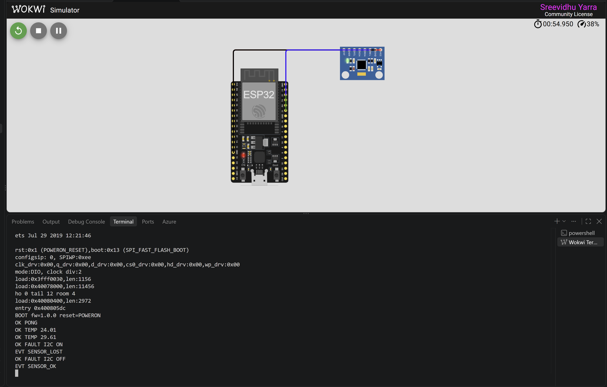
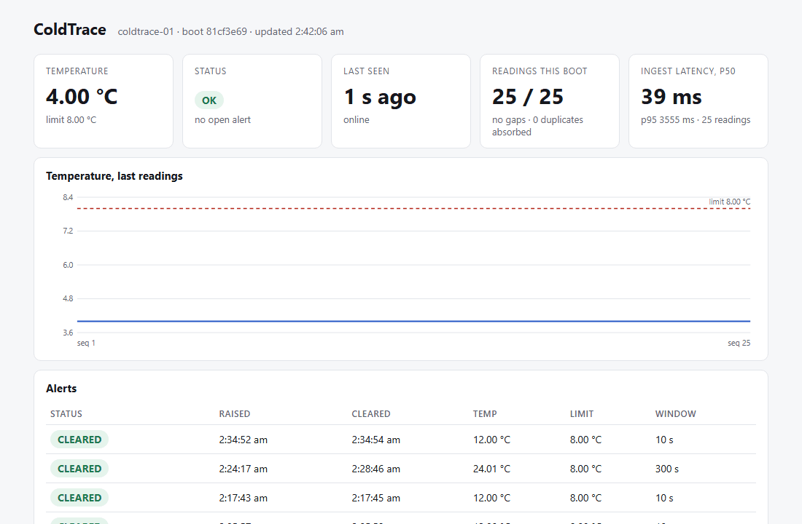

# ESP32 Temperature Logger, HIL Test Harness and ColdTrace

[](https://github.com/sreevidhuyarra/esp32-logger/actions/workflows/ci.yml)

Three projects in one repository, each built on the one before:

1. **Firmware** for an ESP32 that reads temperature from an MPU6050 over I²C, keeps the last 64 samples in a
   ring buffer, and answers text commands over UART. It detects a failed sensor, keeps working, and recovers on
   its own. A task watchdog reboots the chip if the main loop stalls.
2. **A hardware-in-the-loop (HIL) test harness** in Python/pytest that drives the firmware over its serial
   protocol and checks every behaviour: commands, timing, error handling, sensor faults, resets and latency.
   The same 38 tests run against a host simulator (in CI), the real firmware in the
   [Wokwi](https://wokwi.com) simulator, and a real board.
3. **[ColdTrace](#coldtrace-cold-chain-monitoring-on-azure-iot-hub)**: the same firmware as a cold-chain
   monitor on Azure IoT Hub, with store-and-forward through network outages, remote configuration, excursion
   alerts, a dashboard, and an end-to-end test suite that proves each of those against the real cloud.

No hardware is needed for any of it.



## Quick start

```sh
git clone --recursive https://github.com/sreevidhuyarra/esp32-logger.git && cd esp32-logger
make test sim                               # 115 unit tests, then build the host simulator
pip install -r hil/requirements.txt         # Python 3.12
cd hil && pytest --target sim               # 38 HIL tests -> reports/sim-report.html
```

On Windows, use MSYS2's make (`C:\msys64\usr\bin\make.exe test sim`); everything else is the same.

## Results

| Run | Result | Report |
| --- | --- | --- |
| Unit tests (`make test`) | 115 / 115 pass, < 1 s | — |
| Cloud pipeline unit tests (`cd azure && pytest`) | 35 / 35 pass | — |
| ColdTrace end-to-end, Wokwi + Azure | 7 / 7 pass ([below](#results-1)) | [reports/wokwi-cloud-report.html](reports/wokwi-cloud-report.html) |
| HIL, host simulator | 38 / 38 pass in ~34 s; also in random order | [reports/sim-report.html](reports/sim-report.html) |
| HIL, Wokwi (real firmware) | 36 pass, 1 not applicable, 1 known Wokwi limitation (xfail) | [reports/wokwi-report.html](reports/wokwi-report.html) |
| CI (GitHub Actions) | unit, HIL on simulator, firmware build, optional Wokwi boot check | [Actions](https://github.com/sreevidhuyarra/esp32-logger/actions) |


The harness found two real firmware bugs, both now fixed and covered by tests:

- [Bug 003](docs/bugs/003-commands-answered-after-reset-or-hang.md): commands sent right behind `RESET` or
  `FAULT HANG` were still answered, so a setting could be "accepted" and then silently lost in the reboot.
- [Bug 004](docs/bugs/004-uart-rx-overflow-drops-bytes-in-bursts.md): bursts over ~1.5 KB overflowed the
  ESP32's 256-byte serial receive buffer and the next command was lost. Found only on the real firmware in
  Wokwi; the simulator, with no UART, could not show it.

The full traceability from requirement to test to result is in the [test plan](docs/test-plan.md).

## How it fits together

```text
 pytest tests  (smoke · functional · faults · robustness · resets · performance)
        │   device.command("RATE 500") -> Response     events: EVT / BOOT queue
        ▼
 DeviceClient  (hil/embedded_hil)   sorts every line: response, DUMP body, event, noise
        │                           logs the whole conversation into each test's report
        ▼
 Transport ── ProcessTransport ──► build/sim          host simulator   (--target sim, CI)
          └── SerialTransport ───► rfc2217://localhost:4000  Wokwi    (--target wokwi)
                              └──► COM3 / /dev/ttyUSB0       a board  (--target serial)

 Firmware:
 UART ──► src/main.cpp (Arduino: Wire, Serial, watchdog, reset reason)   ─┐
          sim/host_main.c (host: stdin/stdout, fake MPU6050, watchdog) ──┴─► hal_t ─► core/ (portable C99)
                                                                              logger · cmd_parser · ring_buffer · mpu6050
```

- **Same core everywhere.** The firmware logic is portable C99 behind a `hal_t` of function pointers. The ESP32,
  the host simulator and the unit tests each supply their own HAL, so CI tests the exact C that runs on the chip.
- **Events never break responses.** The device can send `EVT S …` or `BOOT …` at any moment. `DeviceClient`
  queues those with timestamps, so a sample arriving mid-command is collected later with `wait_for_event()`.
- **Independent tests.** Before each test a fixture turns streaming and faults off, resets the rate, clears the
  buffer and waits for a healthy sensor. The suite passes in random order.
- **Fault injection** with `FAULT I2C ON|OFF` (unplugged sensor) and `FAULT HANG` (stalled loop), compiled only
  into the test build. A test proves the production build rejects them.
- **Timing without flakiness.** Tests wait for events rather than sleeping, timeouts scale per target (Wokwi ×4),
  and sample spacing is checked with the device's own timestamps.

## Running each target

| Target | Prepare | Run (from `hil/`) |
| --- | --- | --- |
| Host simulator | `make sim` | `pytest --target sim` |
| Wokwi | `cd firmware && pio run`, then in VS Code open `firmware/diagram.json` → F1 → **Wokwi: Start Simulator** | `pytest --target wokwi` |
| Real board | Flash `esp32_test` (`pio run -e esp32_test -t upload`) | `pytest --target serial --port COM3` |

Useful subsets: `pytest -m smoke` (about 1 s), `pytest -m "not slow"`, `pytest -p random_order`.
Reports go to `reports/<target>-report.html` and `reports/<target>-junit.xml`.

## Firmware features

- **I²C driver** for the MPU6050 temperature sensor, with integer-only conversion to centi-degrees
- **UART command protocol** with strict framing: [docs/protocol.md](docs/protocol.md)
- **Ring buffer** of 64 samples that overwrites the oldest and counts what it lost
- **Sensor fault handling:** 3 failed reads mark the sensor LOST, retry every 5 s, recover without a reboot
- **Task watchdog** (3 s) and reset-reason reporting (`POWERON`, `SOFTWARE`, `WATCHDOG`, `OTHER`)
- **Non-blocking main loop:** no `delay()`, wrap-safe timing; no `malloc` or `String` in the core

## Repository layout

| Path | Contents |
| --- | --- |
| `firmware/core/` | Portable C99: HAL interface, ring buffer, command parser, MPU6050 driver, logger, publisher (store and forward), twin reader |
| `firmware/src/main.cpp` | Arduino platform layer |
| `firmware/src/cloud.cpp` | ColdTrace platform layer: Wi-Fi, esp-mqtt over TLS, twin and methods (`esp32_cloud` only) |
| `firmware/test/` | Unity unit tests, the fake HAL and the fake network |
| `firmware/platformio.ini`, `diagram.json`, `wokwi.toml` | Builds (`esp32`, `esp32_test`, `esp32_cloud`) and the Wokwi circuit |
| `firmware/cloud/` | Wokwi project for the `esp32_cloud` build |
| `sim/host_main.c` | Host simulator: the core on a PC |
| `azure/function_app/` | Azure Function: ingest pipeline, Table Storage, dashboard |
| `azure/tests/`, `azure/deploy.ps1` | Cloud logic unit tests; one-command deployment |
| `hil/embedded_hil/` | Harness library: transports, `DeviceClient`, models, `CloudClient` |
| `hil/tests/` | Fixtures, the six device suites and the cloud suite |
| `docs/` | Protocol, test plan, spike notes, bug reports |
| `reports/` | Sample HTML reports and latency results from every target |
| `.github/workflows/ci.yml` | CI pipeline |
| `third_party/unity/` | Unity test framework (submodule) |

## ColdTrace: cold-chain monitoring on Azure IoT Hub

A simulated ESP32 tracks a shipment's temperature, streams it to the cloud, alerts on temperature
excursions, survives network outages and can be reconfigured remotely. An end-to-end test suite proves
each of those behaviours against the real Azure services. Firmware 2.0.0, tag `v2.0.0`.



```text
 Wokwi ESP32 (esp32_cloud build)                     Azure                                     PC
 ┌──────────────────────────────┐  MQTT/TLS 8883  ┌───────────┐  built-in   ┌──────────────┐
 │ core: logger + publisher     │ ──────────────► │ IoT Hub   │ ──endpoint─► │ Function     │
 │  64-slot queue, seq + boot id│   QoS 1, SAS    │ (F1 free) │             │ ingest:      │
 │  stop-and-wait, resend       │ ◄────────────── │ twin,     │             │  de-dup,     │
 │ cloud.cpp: Wi-Fi, esp-mqtt,  │  twin, methods  │ methods   │             │  alerts      │
 │  twin, flush, FAULT NET      │                 └───────────┘             │ status,      │──► dashboard
 └──────────────────────────────┘                       ▲                   │ dashboard    │
            ▲ serial (RFC2217)                          │ az CLI            └──────┬───────┘
            │                                           │                          ▼
 pytest --target wokwi --cloud ─────────────────────────┴──────────────── Table Storage
                                                                     readings · devices · alerts
```

### How it works

- **Store and forward.** Every reading the device reports gets a sequence number (1, 2, 3 … per boot) and
  a random boot id. Readings wait in the firmware's 64-slot ring buffer until IoT Hub acknowledges them
  (MQTT QoS 1); one is in flight at a time and is sent again if no ack arrives in 20 s or the link drops.
  64 slots at one reading per 30 s hold 32 minutes of outage. The logic is portable C with 46 unit tests
  against a fake network.
- **De-duplication.** At-least-once delivery means repeats. The Function stores each reading under
  (device, boot, seq); a repeat bumps a counter instead of adding a row, so the cloud can prove nothing
  was lost (no gaps) or double-counted.
- **Excursion alerts.** Above the limit for longer than the window raises exactly one alert; back below
  clears it. The window is timed with the device's own sample clock, because after an outage the backlog
  arrives all at once and arrival times would make a five-minute excursion look instant.
- **Remote configuration.** The device twin sets the report interval, alarm limit and alert window. The
  device validates each value, applies the valid ones and reports back what it applied (`applied_version`,
  `rejected`). Every reading carries the limit and window in force, so a change reaches the cloud's alert
  check too. A `flush` direct method sends a reading immediately.
- **Concurrency-safe state.** Per-device state is written with optimistic concurrency (ETag `If-Match`),
  and alerts only after that write succeeds ([bug 006](docs/bugs/006-orphaned-alert-from-concurrent-function-instances.md)).
- **Dashboard.** `/api/dashboard` shows temperature against the limit, status, last seen, sequence
  integrity for the current boot (received vs expected, gaps, duplicates absorbed), ingest latency and the
  alert history.

### Results

`pytest --target wokwi --cloud -m cloud` (firmware in Wokwi, real Azure services), 2026-11-17:

| Test | What it proves | Result |
| --- | --- | --- |
| HIL-CT-01 Ingestion latency | Readings reach storage fast (cloud clocks: IoT Hub enqueue → stored) | p50 **34 ms**, p95 **41 ms**; PC `SEND` → row visible p50 1.1 s (includes Wokwi and polling) |
| HIL-CT-02 Network outage | Wi-Fi down 2 minutes: every reading arrives exactly once | 24 readings queued, **all 24 stored, no gaps, 0 dropped**; link back and backlog delivered in ~17 s |
| HIL-CT-03 Duplicates | A reading sent 3 times is stored once and counted | 3 copies received, **1 row** |
| HIL-CT-04 Twin round trip | A cloud setting is applied and confirmed | device applied in ~8 s, confirmed in the cloud in ~13 s (PC clock, includes `az` CLI start-up) |
| HIL-CT-05 Excursion alert | Above the limit past the window: exactly one alert, then clears | 1 alert at 12 °C against 8 °C / 10 s; cleared at 4 °C |
| HIL-CT-06 Security | Bad credentials are refused | valid token accepted; tampered signature, wrong key, and a token expired 15 min ago refused |
| HIL-CT-07 Reboots | `RESET` three times: back as `SOFTWARE`, reconnected, delivering; a real hang still reads `WATCHDOG` | 3 / 3 `SOFTWARE`, reboot to stored reading 11-15 s; hang → `WATCHDOG` ([bug 005](docs/bugs/005-watchdog-reset-during-tls-handshake.md)) |

Every cloud test also fails if the device reboots by watchdog or its loop stalls for 1.5 s or more while
the test runs (half the cloud build's 10 s watchdog); the final run recorded one stall, 3.3 s, during a
reconnect handshake. Four further outage-and-reconnect cycles also passed. Numbers are in `reports/cloud-latency.json`.

### Bugs found

- [Bug 005](docs/bugs/005-watchdog-reset-during-tls-handshake.md), two causes behind one symptom: in Wokwi
  the TLS handshake freezes the CPU for over 3 s (measured 3.3 s with a loop-gap monitor after a
  priority-based fix proved wrong; the cloud build's watchdog is now 10 s), and the timer-group
  watchdog's flash-boot mode survived a software reset and killed the next boot (cleared before restart).
- [Bug 006](docs/bugs/006-orphaned-alert-from-concurrent-function-instances.md): two Function instances
  processing the same backlog orphaned an alert (lost update); fixed with ETag concurrency.
- Azure findings in the [spike notes](docs/spike-notes.md): newer hubs give devices a separate host name
  with an ECC certificate chain (DigiCert Global Root G3), and SAS tokens are accepted for a short while
  after they expire.

### Running it

You need an Azure subscription (Azure for Students works), the Azure CLI with `az extension add -n azure-iot`,
and the VS Code Wokwi extension.

1. **Cloud side:** create an IoT Hub (`--sku F1`) and a device `coldtrace-01`, then run
   `./azure/deploy.ps1 -Hub <hub> -Suffix <unique>`. It creates the storage account, the Function's consumer
   group and the Function App, and deploys `azure/function_app`.
2. **Credentials:** `.venv/Scripts/python azure/device_token.py --hub <hub>` writes
   `firmware/src/secrets.h` (git-ignored) with the hub's main host name and a 30-day device SAS token
   (see `firmware/src/secrets.example.h` for why that host).
3. **Firmware:** `cd firmware && pio run -e esp32_cloud`, open `firmware/cloud/diagram.json` in VS Code,
   F1 → **Wokwi: Start Simulator**.
4. **Tests:** `cd hil && pytest --target wokwi --cloud -m cloud --hub <hub> --storage <account>`.
5. **Dashboard:** `https://<function-app>.azurewebsites.net/api/dashboard?code=<function key>`
   (`az functionapp keys list -n <function-app> -g <group> --query functionKeys.default`).

Serial commands added for ColdTrace (full list in the [protocol](docs/protocol.md)): `NET`, `CFG`,
`REPORT <ms>`, `SEND`, and in the test build `FAULT NET ON|OFF`, `FAULT NOACK ON|OFF`, `FAULT TEMP <°C>|OFF`.

### Honest limits

- **The device is simulated.** The firmware is real ESP32 code running in Wokwi, which runs slower than
  real time; it has not run on a physical board.
- **The outage is simulated** with `FAULT NET`, which really drops Wi-Fi and the MQTT session; pytest cannot
  switch Wokwi's network off from outside.
- **The security test connects from the PC** as a second device identity (`coldtrace-sec`), because IoT Hub
  allows one connection per device and the Wokwi device must stay connected. The check under test, the hub
  refusing bad credentials, is on the server.
- **Shared-key (SAS) authentication** with a pre-generated 30-day token, and the hub's local auth turned
  back on (the current Azure CLI disables it by default). Production would use X.509 device certificates
  or Entra ID, and token rotation.
- **Free tiers:** IoT Hub F1 allows 8,000 messages a day; the default one reading per 30 s uses about 2,900.

## Known Wokwi limitations

- A watchdog reset is reported as ESP-IDF's `INT_WDT`; the firmware maps it to `reset=WATCHDOG`
  ([spike notes](docs/spike-notes.md)).
- `millis()` does not restart after a software reset, so `HIL-RS-04` is `xfail` on Wokwi
  ([bug 002](docs/bugs/002-uptime-not-reset-after-software-reset.md)).
- Wokwi runs slower than real time: `PING` latency there is ~217 ms median versus ~0.13 ms on the simulator.
- A software reset leaves the timer groups' flash-boot watchdog armed; the cloud firmware clears it before
  restarting ([bug 005](docs/bugs/005-watchdog-reset-during-tls-handshake.md)).

## Future work

- Run the suite on a real ESP32 board (`--target serial`)
- Bench instruments through PyVISA (power-supply brown-out tests), a relay to really unplug the sensor
- CRC on sample lines; persist samples to flash
- ColdTrace: X.509 device certificates and token rotation; persist the publish queue so a reboot during an
  outage loses nothing; a fleet simulator (20-50 virtual devices) and alert e-mails
