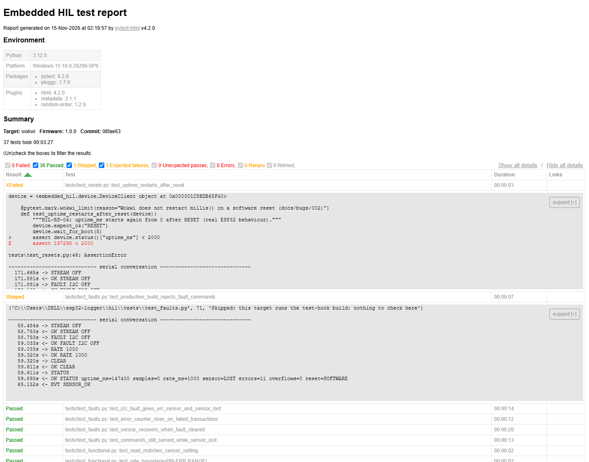

# ESP32 Temperature Logger — Firmware and HIL Test Harness

[](https://github.com/sreevidhuyarra/esp32-logger/actions/workflows/ci.yml)

Two projects in one repository:

1. **Firmware** for an ESP32 that reads temperature from an MPU6050 over I²C, keeps the last 64 samples in a
   ring buffer, and answers text commands over UART. It detects a failed sensor, keeps working, and recovers on
   its own. A task watchdog reboots the chip if the main loop stalls.
2. **A hardware-in-the-loop (HIL) test harness** in Python/pytest that drives the firmware over its serial
   protocol and checks every behaviour: commands, timing, error handling, sensor faults, resets and latency.
   The same 38 tests run against a host simulator (in CI), the real firmware in the
   [Wokwi](https://wokwi.com) simulator, and a real board.

No hardware is needed for any of it.


## Quick start

```sh
git clone --recursive https://github.com/sreevidhuyarra/esp32-logger.git && cd esp32-logger
make test sim                               # 59 unit tests, then build the host simulator
pip install -r hil/requirements.txt         # Python 3.12
cd hil && pytest --target sim               # 38 HIL tests -> reports/sim-report.html
```

On Windows, use MSYS2's make (`C:\msys64\usr\bin\make.exe test sim`); everything else is the same.

## Results

| Run | Result | Report |
| --- | --- | --- |
| Unit tests (`make test`) | 59 / 59 pass, < 1 s | — |
| HIL, host simulator | 38 / 38 pass in ~34 s; also in random order | [reports/sim-report.html](reports/sim-report.html) |
| HIL, Wokwi (real firmware) | 36 pass, 1 not applicable, 1 known Wokwi limitation (xfail) | [reports/wokwi-report.html](reports/wokwi-report.html) |
| CI (GitHub Actions) | unit, HIL on simulator, firmware build, optional Wokwi boot check | [Actions](https://github.com/sreevidhuyarra/esp32-logger/actions) |



The harness found two real firmware bugs, both now fixed and covered by tests:

- [Bug 003](docs/bugs/003-commands-answered-after-reset-or-hang.md): commands sent right behind `RESET` or
  `FAULT HANG` were still answered, so a setting could be "accepted" and then silently lost in the reboot.
- [Bug 004](docs/bugs/004-uart-rx-overflow-drops-bytes-in-bursts.md): bursts over ~1.5 KB overflowed the
  ESP32's 256-byte serial receive buffer and the next command was lost. Found only on the real firmware in
  Wokwi; the simulator, with no UART, could not show it.

The full traceability from requirement to test to result is in the [test plan](docs/test-plan.md).

## How it fits together

```text
 pytest tests  (smoke · functional · faults · robustness · resets · performance)
        │   device.command("RATE 500") -> Response     events: EVT / BOOT queue
        ▼
 DeviceClient  (hil/embedded_hil)   sorts every line: response, DUMP body, event, noise
        │                           logs the whole conversation into each test's report
        ▼
 Transport ── ProcessTransport ──► build/sim          host simulator   (--target sim, CI)
          └── SerialTransport ───► rfc2217://localhost:4000  Wokwi    (--target wokwi)
                              └──► COM3 / /dev/ttyUSB0       a board  (--target serial)

 Firmware:
 UART ──► src/main.cpp (Arduino: Wire, Serial, watchdog, reset reason)   ─┐
          sim/host_main.c (host: stdin/stdout, fake MPU6050, watchdog) ──┴─► hal_t ─► core/ (portable C99)
                                                                              logger · cmd_parser · ring_buffer · mpu6050
```

- **Same core everywhere.** The firmware logic is portable C99 behind a `hal_t` of function pointers. The ESP32,
  the host simulator and the unit tests each supply their own HAL, so CI tests the exact C that runs on the chip.
- **Events never break responses.** The device can send `EVT S …` or `BOOT …` at any moment. `DeviceClient`
  queues those with timestamps, so a sample arriving mid-command is collected later with `wait_for_event()`.
- **Independent tests.** Before each test a fixture turns streaming and faults off, resets the rate, clears the
  buffer and waits for a healthy sensor. The suite passes in random order.
- **Fault injection** with `FAULT I2C ON|OFF` (unplugged sensor) and `FAULT HANG` (stalled loop), compiled only
  into the test build. A test proves the production build rejects them.
- **Timing without flakiness.** Tests wait for events rather than sleeping, timeouts scale per target (Wokwi ×4),
  and sample spacing is checked with the device's own timestamps.

## Running each target

| Target | Prepare | Run (from `hil/`) |
| --- | --- | --- |
| Host simulator | `make sim` | `pytest --target sim` |
| Wokwi | `cd firmware && pio run`, then in VS Code open `firmware/diagram.json` → F1 → **Wokwi: Start Simulator** | `pytest --target wokwi` |
| Real board | Flash `esp32_test` (`pio run -e esp32_test -t upload`) | `pytest --target serial --port COM3` |

Useful subsets: `pytest -m smoke` (about 1 s), `pytest -m "not slow"`, `pytest -p random_order`.
Reports go to `reports/<target>-report.html` and `reports/<target>-junit.xml`.

## Firmware features

- **I²C driver** for the MPU6050 temperature sensor, with integer-only conversion to centi-degrees
- **UART command protocol** with strict framing: [docs/protocol.md](docs/protocol.md)
- **Ring buffer** of 64 samples that overwrites the oldest and counts what it lost
- **Sensor fault handling:** 3 failed reads mark the sensor LOST, retry every 5 s, recover without a reboot
- **Task watchdog** (3 s) and reset-reason reporting (`POWERON`, `SOFTWARE`, `WATCHDOG`, `OTHER`)
- **Non-blocking main loop:** no `delay()`, wrap-safe timing; no `malloc` or `String` in the core

## Repository layout

| Path | Contents |
| --- | --- |
| `firmware/core/` | Portable C99: HAL interface, ring buffer, command parser, MPU6050 driver, logger |
| `firmware/src/main.cpp` | Arduino platform layer |
| `firmware/test/` | Unity unit tests and the fake HAL |
| `firmware/platformio.ini`, `diagram.json`, `wokwi.toml` | Builds (`esp32`, `esp32_test`) and the Wokwi circuit |
| `sim/host_main.c` | Host simulator: the core on a PC |
| `hil/embedded_hil/` | Harness library: transports, `DeviceClient`, models |
| `hil/tests/` | Fixtures and the six test suites |
| `docs/` | Protocol, test plan, spike notes, bug reports |
| `reports/` | Sample HTML reports and latency results from both targets |
| `.github/workflows/ci.yml` | CI pipeline |
| `third_party/unity/` | Unity test framework (submodule) |

## Known Wokwi limitations

- A watchdog reset is reported as ESP-IDF's `INT_WDT`; the firmware maps it to `reset=WATCHDOG`
  ([spike notes](docs/spike-notes.md)).
- `millis()` does not restart after a software reset, so `HIL-RS-04` is `xfail` on Wokwi
  ([bug 002](docs/bugs/002-uptime-not-reset-after-software-reset.md)).
- Wokwi runs slower than real time: `PING` latency there is ~217 ms median versus ~0.13 ms on the simulator.

## Future work

- Run the suite on a real ESP32 board (`--target serial`)
- Bench instruments through PyVISA (power-supply brown-out tests), a relay to really unplug the sensor
- CRC on sample lines; persist samples to flash
